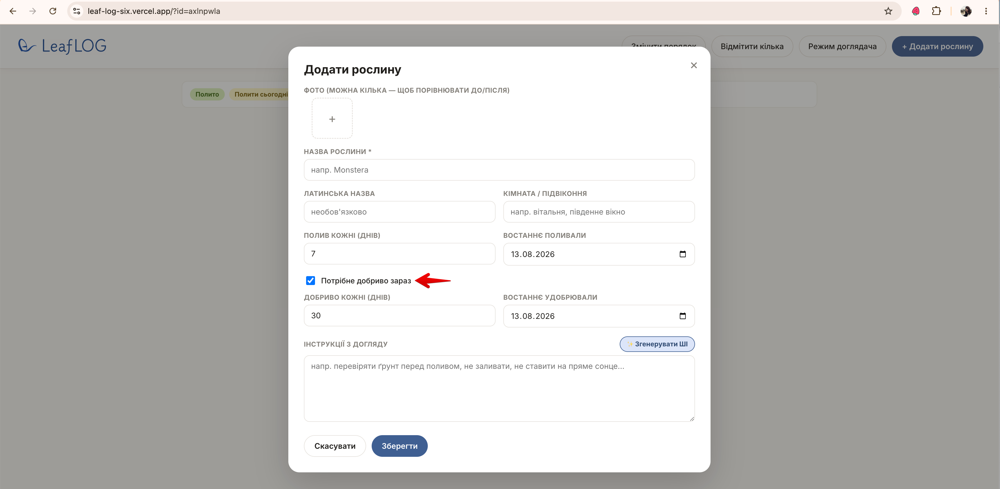
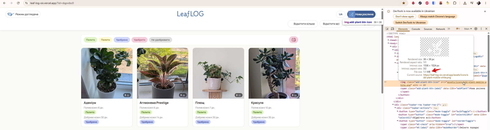

## BR-001 Rename unclear fertilizing checkbox label in Add and Edit Plant forms

**Status:** Fixed (verified 2026-10-29): the label is now «Увімкнути підживлення» / «Fertilizing enabled».

### Summary
Fertilizing checkbox label uses unclear wording in Add Plant and Edit Plant forms and should be renamed for better clarity and future English localization

### Steps to Reproduce
1. Open the site https://leaf-log-six.vercel.app/?id=rycu0sei
2. Click **"Додати рослину"**
3. Observe the fertilizing checkbox label in the Add Plant form
4. Close the form
5. Open any existing plant card
6. Click **"Редагувати"**
7. Observe the same fertilizing checkbox label in the Edit Plant form

### Actual Result
- The checkbox label is displayed as **"Потрібне добриво зараз"**
- The wording is ambiguous and may suggest an immediate one-time fertilizing action instead of a setting that enables fertilizing tracking
- The same unclear wording is used in both Add Plant and Edit Plant forms

### Expected Result
- The checkbox label should be renamed in both Add Plant and Edit Plant forms
  - Ukrainian label should be: **"Увімкнути підживлення"**
  - English label should be: **"Fertilizing enabled"**

### Attachment

## BR-002 Caretaker mode does not allow entering bulk-select flow for updating multiple plants

**Status:** Closed, no longer reproducible (2026-10-29): «Select multiple» can be enabled together with Caretaker mode (see FR-143 in Functional Requirements).

### Summary
When Caretaker mode is enabled, the user cannot use bulk-select / bulk-edit style flow, but caretaker users should be able to mark several plants as watered at once.

### Steps to Reproduce
1. Open the site.
2. Enable **"Режим доглядача"**.
3. Try to update multiple plants at once.
4. Check whether bulk-select mode can be entered or whether a multi-plant watering action is available.

### Actual Result
- In Caretaker mode, the user cannot use bulk-select mode.
- There is no available flow for marking several plants as watered at once while staying in Caretaker mode.
- The caretaker is limited to updating plants one by one.

### Expected Result
- In Caretaker mode, the user should be able to update multiple plants in one flow.
- The caretaker should have a way to mark several plants as watered at once.
- A bulk watering option should be available for caretaker usage without requiring access to full editing functionality.

## BR-003 AI replies are always in Ukrainian regardless of the selected UI language

**Status:** Fixed (2026-11-04). `index.html` sends `lang` (`uk` / `en`) with both AI requests; `api/diagnose.js` and `api/generate-instructions.js` ask the model to answer in that language (unknown or missing `lang` falls back to Ukrainian). Covered by tests A5–A7 and `api-ai-language.spec.ts`. To be re-verified manually on the deployed site, because the real model output cannot be checked in automated tests.

### Summary
The language switcher changes the interface language, but AI care suggestions and AI answers stay in Ukrainian. Feature Requirements v1.2 (LF-005, LF-006) expect them to follow the selected language.

### Steps to Reproduce
1. Open the site https://leaf-log-six.vercel.app/?id=rycu0sei
2. Switch the UI language to English (`EN`).
3. Open any plant and, in the question field, type `Leaves are turning yellow`; click **Ask AI**.
4. Observe the language of the answer.
5. Close the detail view, click **New plant**, type a plant name and click **Generate with AI**.
6. Observe the language of the generated care instructions.

### Actual Result
- The answer to the question is in Ukrainian.
- The generated care instructions are in Ukrainian.

### Expected Result
- With the English UI, the answer and the generated instructions are in English; with the Ukrainian UI they are in Ukrainian.

### Notes
- Code review: the prompts in `api/diagnose.js` and `api/generate-instructions.js` are hard-coded in Ukrainian, and the requests sent from `index.html` do not include the selected language.
- Related requirements: LF-005, LF-006, AC-L-05; known limitation KL-013.

## BR-005 Oversized “Add plant” icon slows page load

**Status:** Open (re-checked 2026-11-20).

### Summary
The "Нова рослина" button icon file is much larger than its displayed size and adds unnecessary weight to every page load.

### Steps to Reproduce
1. Open the site https://leaf-log-six.vercel.app/?id=rycu0sei with DevTools → Network open (filter "Img", cache disabled).
2. Reload the page.
3. Find `add-plant-mobile-white.png` (`assets/icons/`) and check its size.
4. In Elements, check the rendered size of `.add-plant-btn-icon` in the header button.

### Actual Result
- File size is **1.09 MB** (1536 × 1024 px)
- The icon is displayed at 36×36 px (desktop) and 32×32 px (mobile)
- Other icons in `assets/icons/` are 2.5–43 KB

### Expected Result
- The icon file is optimized to **30 KB or less** (about 72×72 px for retina) with no visible loss of quality

### Attachment

